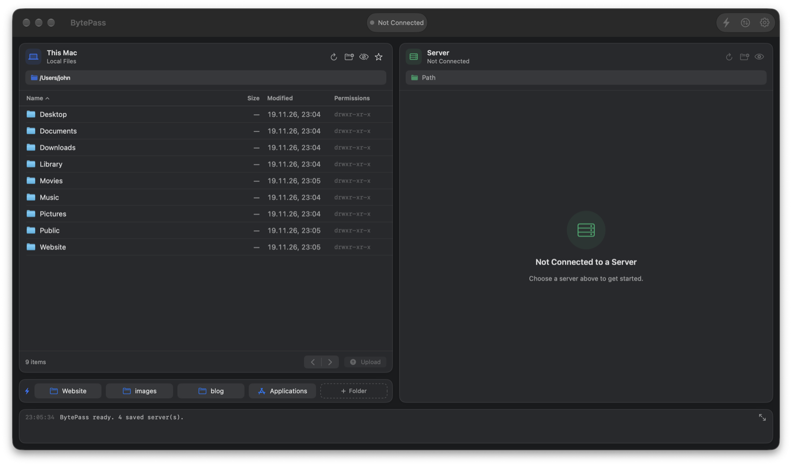

# BytePass – Free SFTP Client for macOS

A native SFTP client for macOS with built-in server backups. Manage servers, transfer files and create encrypted backups (AES-256). A free alternative to FileZilla, Cyberduck and Transmit.

**Build:** macOS 14+, Xcode Command Line Tools → `./build_app.sh`

Feedback and ideas are welcome – just open an [issue](../../issues).

MIT License © sami_i04

---
filezilla alternative, cyberduck alternative, transmit alternative, sftp client, mac sftp, ftp client macos, server backup, swift, macos
